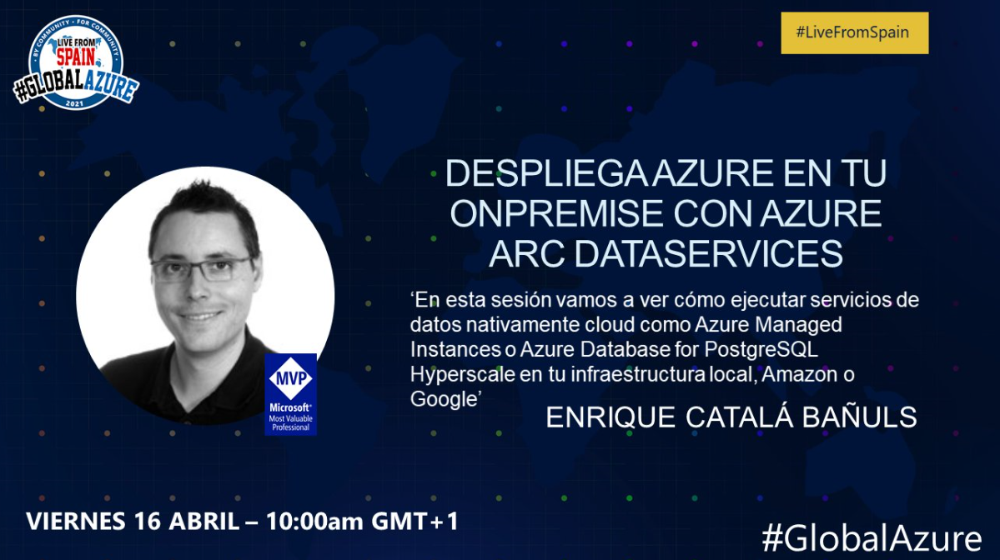

El próximo viernes 16 de Abril de 2021 tengo el honor de impartir una sesion en la [#GlobalAzure](https://globalazure.es/) junto a grandes cracks de renombre nacional e internacional. 

En mi sesión vamos a ver **cómo traernos servicios PaaS de datos como SQL Managed Instances a nuestro entorno OnPremise (o a cualquier otro sitio fuera de Azure)** utilizando _Azure Arc for dataservices_.

